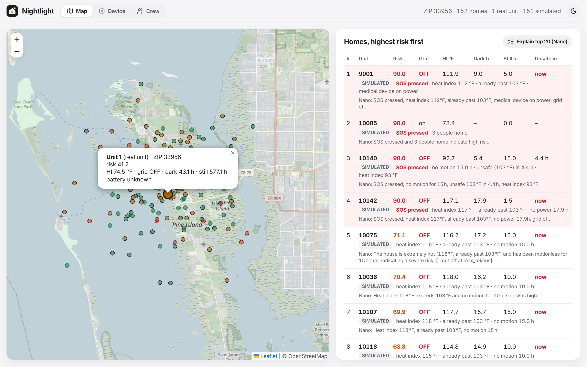
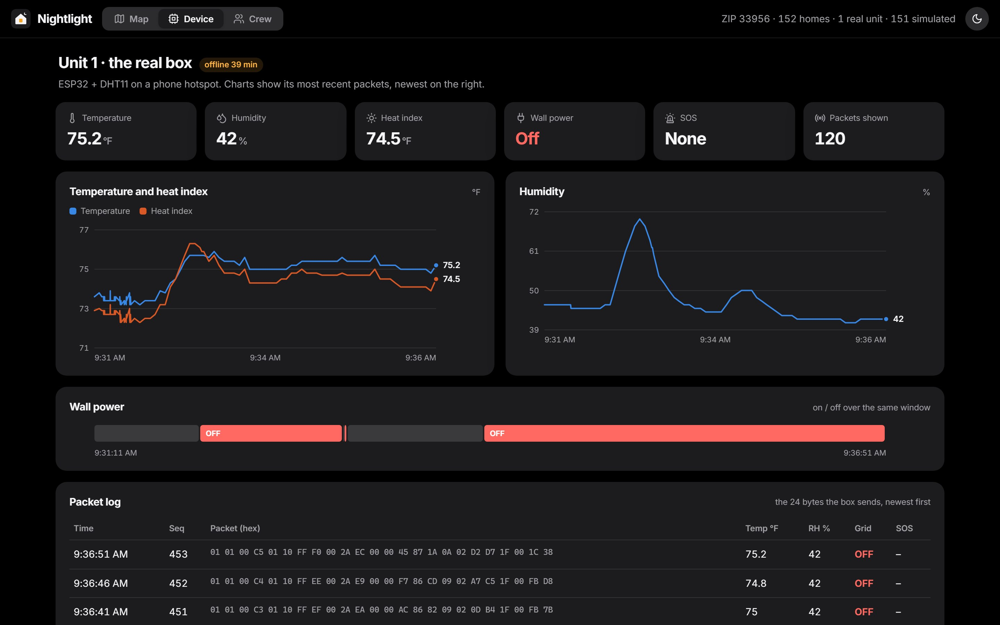
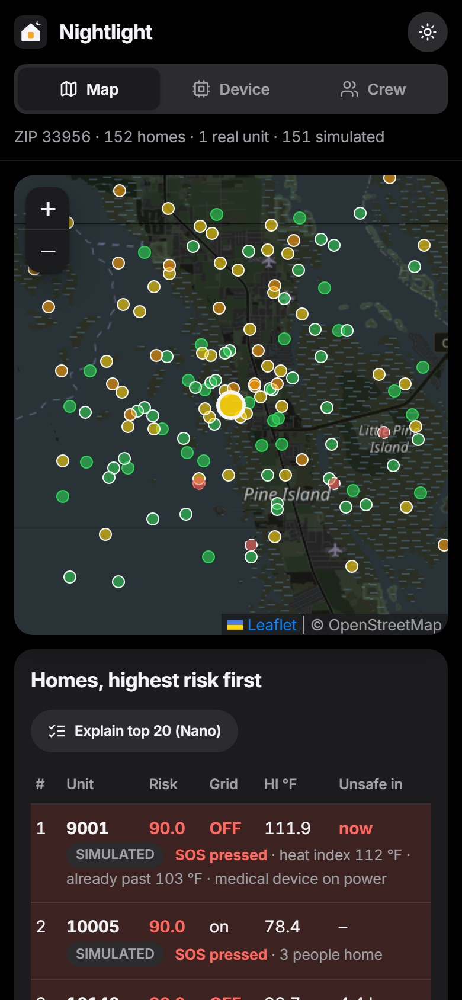
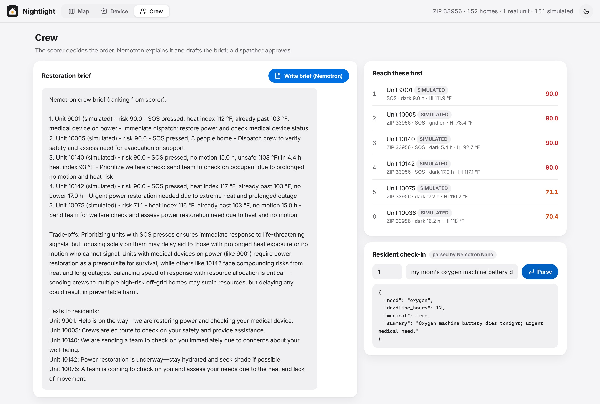
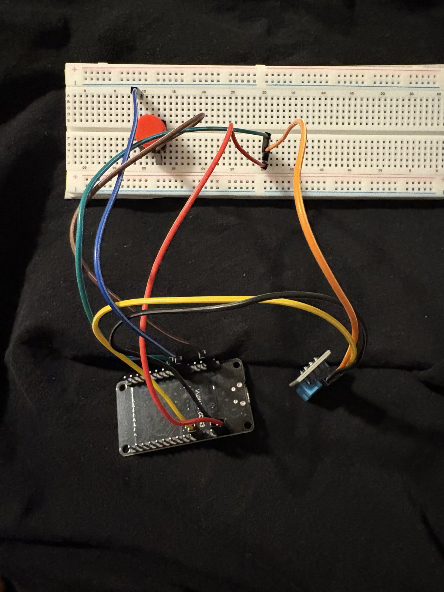

# Nightlight

**Utilities can see the grid go dark. Nightlight sees who's still in the dark.**

A $15 ESP32 box that keeps reporting from a Florida home after a hurricane knocks the power out: grid on or off, indoor heat index, signs of life, and an SOS button. The cloud ranks every home by danger with a deterministic scorer, and NVIDIA Nemotron on Nebius Token Factory explains the ranking and writes the restoration crew's brief.

<p>
  
  
  
  
  
  
  <br>
  
  
  
  
  
  
  
  
  <br>
  
  
  
  
  
  
  
  <a href="LICENSE"></a>
</p>

<!-- TODO(mate): add the demo video link here once it's uploaded, e.g. [▶ Watch the demo](https://youtu.be/...) -->



Built for the **Nebius x NVIDIA Global AI Hackathon** (Physical AI track).

After a hurricane, a utility knows which feeders are down. It doesn't know which homes behind them hold someone on oxygen, someone 80 years old in a 110 °F living room, or someone who stopped moving hours ago. In ZIP 33956 on Pine Island (Lee County), 51 Medicare users depend on electricity-powered medical equipment ([HHS emPOWER](https://empowerprogram.hhs.gov/)), and 55% of its 1,852 households include someone 65 or older ([Census ACS 2023](https://api.census.gov/)). Nightlight puts a cheap box in those homes that keeps talking when the grid doesn't.

## What it does

- **A box that survives the outage.** An ESP32 on a power bank reads a DHT11 for heat index, an HC-SR04 for signs of life, wall power and an SOS button. It sends a 24-byte packet every few seconds over a phone hotspot, and queues packets when the hotspot drops.
- **Ranks every home, the same way every time.** A deterministic scorer weighs indoor heat, how fast it's rising, hours without power, hours without motion, medical load and occupants. Pressing SOS puts a home at 90 or above. Each reason comes out as a plain phrase with its number: "heat index 117 °F · already past 103 °F · no power 17.9 h".
- **Forecasts when a home turns dangerous.** A trend over the unit's own readings estimates the hours until the heat index passes 103 °F, shown as "Unsafe in 4.4 h" or "now".
- **Nemotron explains, it never decides.** Nano writes one line per top home and turns a resident's text ("my mom's oxygen machine battery dies tonight") into a structured need. Super writes the crew's restoration brief and texts to residents. Ultra weighs trade-offs for the cooling-hub plan.
- **A console for the dispatcher.** A map of every home, the real box live with charts and its raw packet log, and a crew view with the brief. A person approves every action, and nothing touches grid equipment.
- **Island-scale planning.** A Nebius Serverless Job compares Nightlight's restoration order to biggest-feeder-first, sites cooling hubs, and forecasts county outages with a model tested on Hurricane Milton.

<table>
  <tr>
    <td width="62%"></td>
    <td width="38%"></td>
  </tr>
  <tr>
    <td><b>Device.</b> The one real box, live: readings, charts and every packet it sent.</td>
    <td><b>Phone.</b> The same console works on a dispatcher's phone.</td>
  </tr>
</table>



## How it works


1. **Sense.** The ESP32 reads the DHT11 and computes the heat index on the device. A change in the HC-SR04 distance counts as motion. A grid-sense pin reports wall power.
2. **Send.** Every reading becomes a 24-byte packet with a CRC-16, base64-encoded and posted to `POST /v1/ingest` with the unit's key. The format is frozen: see [docs/PACKET.md](docs/PACKET.md).
3. **Score.** The server keeps each unit's history in SQLite, forecasts hours to unsafe, and ranks every home with [`scorer.py`](cloud/app/scorer.py):
   ```
   risk = 100 × (0.30 heat + 0.20 trend + 0.15 dark + 0.15 still + 0.10 medical + 0.05 generator + 0.05 occupants)
   SOS pressed → risk is at least 90
   ```
4. **Explain.** Nemotron gets only the scorer's reasons and numbers, and is told not to re-rank or add facts. With no key or no credits, the brief falls back to a template labeled "scorer only, Nemotron not called".
5. **Decide.** The dispatcher reads the brief on the Crew tab and sends the crew. Nightlight never acts on its own.

More detail: [docs/ARCHITECTURE.md](docs/ARCHITECTURE.md).

## What's real and what's simulated

| Real | Simulated (labeled SIMULATED in the UI and `synthetic: true` in data) |
|---|---|
| One ESP32 unit: DHT11 heat, HC-SR04 motion, grid sense, SOS, LED | Every other home on the map |
| Phone hotspot uplink to the cloud | The island-wide outage scenario |
| Cloud API, scorer, forecast and every Nemotron call | |
| Public data: EAGLE-I, HHS emPOWER, NOAA HURDAT2, Census ACS | |



Honest limits:

- **One real unit.** Every other home is synthetic. Simulated homes are seeded from the real emPOWER and Census ratios for their ZIP, so the mix of medical and elderly homes is realistic.
- **Accelerated clock.** The demo firmware runs hours dark and hours since motion 900× faster (1 real second = 15 simulated minutes), because nobody can wait 14 hours on camera. `DEMO_SPEEDUP 1.0` is real time.
- **Battery is not measured.** A plain power bank reports nothing, so the unit sends "unknown" (255) instead of a made-up percentage.
- **Motion is an ultrasonic distance change**, not a PIR sensor (none in our kit).
- **The relay is optional** and not in the demo build. Shedding the AC to protect a medical load is designed (`HAS_RELAY`) but not filmed.
- **Location is coarse on purpose.** Units report a ZIP code, never an address.

## Getting started

You need Python 3.11+. The console and a simulated fleet run on a laptop with no hardware.

```bash
git clone https://github.com/kateye31/nvidianebius-hackathon.git && cd nvidianebius-hackathon
cp .env.example .env              # add NEBIUS_API_KEY, model IDs, INGEST_KEY, HOME_ZIP

# 1. server + console on http://localhost:8000
cd cloud
python -m venv .venv
.venv/Scripts/activate            # macOS/Linux: source .venv/bin/activate
pip install -r requirements.txt
pytest -q
uvicorn app.main:app --reload --host 0.0.0.0 --port 8000   # 0.0.0.0 so the ESP32 can reach it

# 2. new terminal (same INGEST_KEY as .env): one test unit, then 150 simulated homes seeded from ZIP 33956
python tools_send_test_packet.py
python tools_send_test_packet.py --fleet 150 --zip 33956
```

| Setting or command | What it does |
|---|---|
| `NEBIUS_API_KEY`, `NEMOTRON_*_MODEL` | Turns on Nemotron. Without them, the brief uses the labeled template and check-ins return 503 instead of guessing |
| `HOME_ZIP=33956` | ZIP of the real unit, shown on the map and used for the brief's live context |
| `TAVILY_API_KEY` | Live NWS heat advisories and restoration news in the crew brief (optional) |
| `--fleet N --zip Z` | N simulated homes seeded from ZIP Z's real ratios (`data/fetch_empower.py` first) |

All settings are listed in [.env.example](.env.example).

**Hardware:** [firmware/README.md](firmware/README.md) and the step-by-step [ESP32 build guide](docs/esp32-guide.html), with every wire color and pin.
**Simulation:** [sim/README.md](sim/README.md). **Data:** [docs/DATA.md](docs/DATA.md).

### API

| Endpoint | What |
|---|---|
| `POST /v1/ingest` | The ESP32's 24-byte packet, base64 (`X-Unit-Key` header). Optional `lat`, `lon`, `zip` beside it |
| `POST /api/packet` | The same data as plain JSON, for curl and debugging (same header) |
| `GET /v1/homes` | Homes ranked by the scorer, with plain-language reasons |
| `GET /v1/history?unit_id=1` | One unit's recent readings with the raw packet as hex |
| `GET /v1/brief` | Crew brief: Nemotron Super, or a labeled scorer-only template |
| `POST /v1/checkin` | Resident free text → structured need (Nemotron Nano) |
| `GET /v1/triage?top=20` | One line per top home (Nemotron Nano fan-out, semaphore 20) |
| `GET /v1/sim` | Latest Serverless Job outputs, each labeled simulated or real |
| `GET /v1/usage` | Token Factory calls, tokens and average latency per model |

## How we used NVIDIA and Nebius

| What | Where |
|---|---|
| Nemotron Nano: check-in parsing, per-home triage fan-out | [`cloud/app/agents/`](cloud/app/agents/) |
| Nemotron Super: crew restoration brief grounded on scorer output | [`crew_brief.py`](cloud/app/agents/crew_brief.py) |
| Nemotron Ultra: a few hard trade-off calls | [`sim/hubs.py`](sim/hubs.py) |
| Nebius Token Factory: every model call (OpenAI-compatible API) | [`client.py`](cloud/app/agents/client.py) |
| Nebius Serverless Endpoint: hosts the API and console | [`cloud/Dockerfile`](cloud/Dockerfile) |
| Nebius Serverless Job: outage simulation and prediction | [`sim/Dockerfile`](sim/Dockerfile) |

Nano and Super run with reasoning switched off: with it on, Super spent its whole token budget thinking and the brief came back cut off after one line. Feedback on the tools: [docs/FEEDBACK.md](docs/FEEDBACK.md).

## Repo layout

| Folder | What |
|---|---|
| [`firmware/`](firmware/) | ESP32 Arduino sketch: sensors, packet encoder, offline queue, optional relay |
| [`cloud/app/`](cloud/app/) | FastAPI ingest, scorer, forecast, Nemotron agents |
| [`dashboard/`](dashboard/) | Leaflet console, plain HTML/CSS/JS with no build step |
| [`sim/`](sim/) | Nebius Serverless Job: outage simulation, Milton forecaster, hubs, demand response |
| [`data/`](data/) | Download scripts for the real public data (raw files are gitignored) |
| [`docs/`](docs/) | [Architecture](docs/ARCHITECTURE.md), [packet contract](docs/PACKET.md), [safety](docs/SAFETY.md), [demo script](docs/DEMO.md) |

## Safety and privacy

No mains wiring, and no control of real grid equipment: the only actuator is a relay on a low-voltage power-bank circuit. Units store a medical-load flag, never a diagnosis, and a ZIP code, never an address. See [docs/SAFETY.md](docs/SAFETY.md).

## Credits

- Data: [EAGLE-I](https://doi.org/10.6084/m9.figshare.24237376) outage records (ORNL), [HHS emPOWER](https://empowerprogram.hhs.gov/), [NOAA HURDAT2](https://www.nhc.noaa.gov/data/hurdat/), [U.S. Census ACS](https://api.census.gov/).
- Models: [NVIDIA Nemotron](https://www.nvidia.com/en-us/ai-data-science/foundation-models/nemotron/) on [Nebius Token Factory](https://nebius.com/).
- Map tiles: © [OpenStreetMap](https://www.openstreetmap.org/copyright) contributors. Icons: [Lucide](https://lucide.dev/).

## What's next

- **Measure the battery.** A power bank with a readable charge, or a voltage divider on a LiPo, so "hours of backup left" joins the score.
- **Film the relay.** Shed the AC automatically when the grid drops so the medical load lasts longer on backup.
- **Mesh when the cell network fails.** LoRa between neighboring boxes so one hotspot can carry a whole street.
- **Ask the resident.** Turn a resident's check-in text into a scorer input, with a person confirming it first.

## Team

<!-- TODO(mate): one line per teammate with their GitHub, e.g. **Name** - Hardware - [@github](https://github.com/username) -->

- **Arwa**: hardware and firmware
- **Katrina** ([@kateye31](https://github.com/kateye31)): cloud, console and data

## License

MIT. See [LICENSE](LICENSE).
