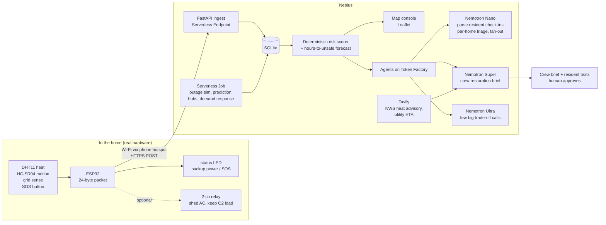

# Architecture

## Pipeline



## Layers and what is real

| Layer | Real or simulated | Notes |
|---|---|---|
| ESP32 unit | **Real** (1 unit) | filmed for the 1-minute hardware clip; demo clock 900×, battery unknown |
| Phone relay | **Real** | ESP32 joins phone hotspot, posts over HTTPS |
| Cloud ingest/scorer/console | **Real**, live | Nebius Serverless Endpoint |
| Nemotron calls | **Real** | Token Factory |
| Other homes on the map | **Simulated**, labeled | seeded from real emPOWER ZIP ratios + Census |
| Outage scenario | **Simulated**, labeled | shaped by real EAGLE-I outage curves |
| Outage prediction model | **Real data** | trained on EAGLE-I + NOAA tracks, tested on Milton |

## Why HTTP instead of MQTT to the cloud

A Serverless Endpoint serves HTTP; hosting a broker there is extra work. The
ESP32 POSTs the raw packet (base64) to `/v1/ingest`. MQTT stays available for
bench testing with a local Mosquitto broker if wanted.

## Risk score (deterministic)

```
heat   = clamp((HI_now_F - 80) / 45, 0, 1)          # NWS caution -> extreme danger
trend  = clamp(hours_to_unsafe -> 1 at 0h, 0 at 12h)
dark   = clamp(minutes_dark / 1440, 0, 1)
still  = clamp(minutes_since_motion / 720, 0, 1)    # no motion for 12h = 1
med    = 1 if medical_load flag else 0
gen    = 1 if on_generator_suspected else 0
sos    = 1 if SOS pressed

risk = 100 * min(1, 0.30*heat + 0.20*trend + 0.15*dark + 0.15*still
                    + 0.10*med + 0.05*gen + 0.05*occupants_norm)
if sos: risk = max(risk, 90)
```
Weights live in `cloud/app/scorer.py` and are explained in the README so
judges can see the reasoning. The LLM never changes them.

## Hours-to-unsafe forecast

Least-squares line through the last N heat-index readings against the device
clock (`uptime_s`, so it is in the same accelerated hours as `min_dark` during
the demo); solve for when it crosses 103 °F (NWS "danger"). A reboot resets
the series. Shown on the map.

## Agent layout (Token Factory)

| Agent | Model | Calls per run | Job |
|---|---|---|---|
| Check-in parser | Nano | 1 per message | free text -> `{need, deadline_hours, medical}` JSON |
| Home triage | Nano | 1 per home (fan-out, semaphore 20) | one-line why for each ranked home |
| Crew brief | Super | 1 per refresh | ranked streets, reasons, trade-offs, resident texts |
| Trade-off judge | Ultra | 1–3 per run | hub placement / which feeder first when scores tie |

All prompts get scorer output as JSON and must quote its fields.

## Simulation job (`sim/`)

1. `seed_homes.py` — synthetic homes for a ZIP using emPOWER electricity-
   dependent ratios and Census household counts (labeled synthetic).
2. `outage_sim.py` — replays an outage curve; compares *biggest feeder first*
   vs *Nightlight ordering*; outputs person-hours above 103 °F.
3. `predict/train.py` — county outage forecaster on EAGLE-I (2014–2024) +
   storm tracks; held-out test on Milton (2024).
4. `hubs.py` — where to put resilience hubs / mobile batteries.
5. `demand_response.py` — blue-sky: cycle AC during heat peaks, never medical loads.

Priority if time runs out: 1 → 2 → 3 → 4 → 5.
